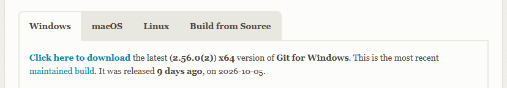

# git
Adriano 2026-10-14

---
    git
    ├── prentation globale de git
    ├── de git a github

---

## C'est quoi Git ?

---

Git est un **outil de contrôle de version** qui est rapidement devenu incontournable dans l'écosystème du développement logiciel. Grâce à sa capacité à conserver un historique minutieux des modifications apportées sur un projet, Git représente un allié précieux pour tout développeur soucieux de gérer efficacement ses projets.

---

## A quoi sa sert ?

---

Git est un **gestionnaire de versions** (VCS, Version Control System). Il te permet de :

- Garder l’historique. Git enregistre l’état du projet à des instants précis. Un bug apparaît ? Tu reviens à une version qui marchait.
- Bosser en équipe sans te marcher dessus. Plusieurs devs travaillent en même temps, même sur un fichier commun. Git fusionne les modifs.
- Tester sans casser. Tu crées un espace isolé pour essayer une fonctionnalité sans toucher à la version en production.
- Savoir qui a fait quoi. Chaque modif est signée, avec un message d’explication.

---

## comment sa marche ?

---

Sur ta machine, Git découpe le projet en **trois espaces**. Tes modifs voyagent de l’un à l’autre :

- Le répertoire de travail. Le dossier visible. Tu y crées, modifies et supprimes tes fichiers normalement.
- La zone de transit (staging area). La salle d’attente. Tu y places les modifs prêtes à être sauvegardées. Ça te laisse trier ce que tu valides.
- Le dépôt local. La base de données cachée de Git (dossier .git). Quand tu valides la zone de transit, Git prend une « photo » du projet (un commit) et l’enregistre dans l’historique.

---

# de Git a Github

Voici la procedure de A a Z pour passer de git a github et savoir travailler avec les deux

---

# telecharger git
rendez vous sur ce site [GIT](https://git-scm.com/install/windows) puis cliquez sur "click here to download"

---

Une fois telechargé ouvrez votre fichier et installer le.
A la fin de l'installation il devrait s'ouvrir automatiquement sur visual studio code si ce n'est pas le cas ouvrez visual studio puis rendez vous

